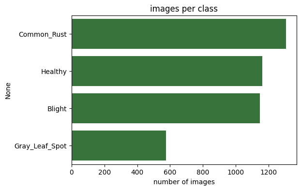
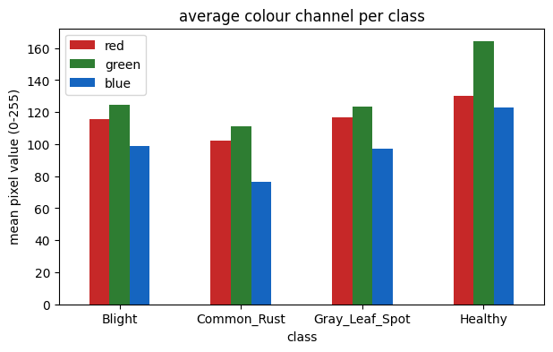
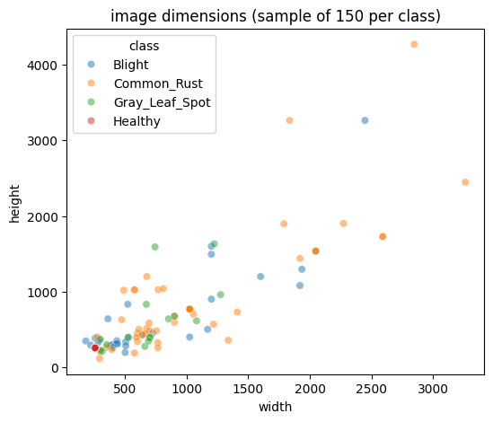
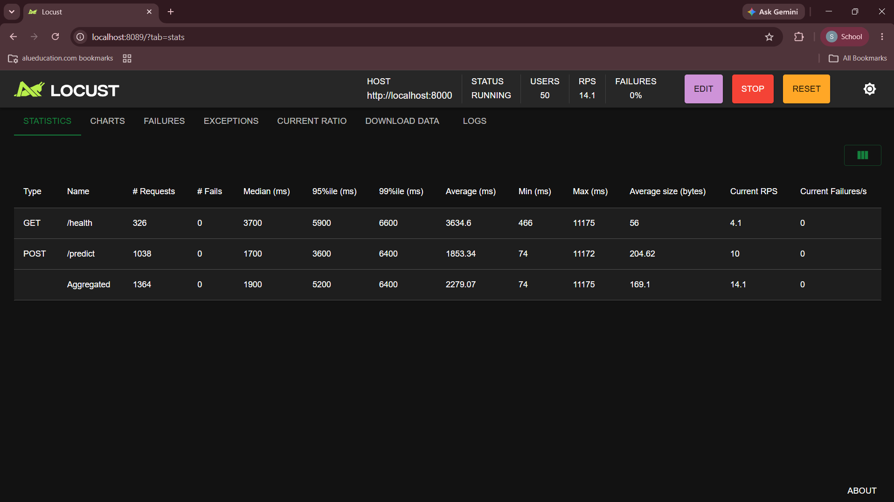
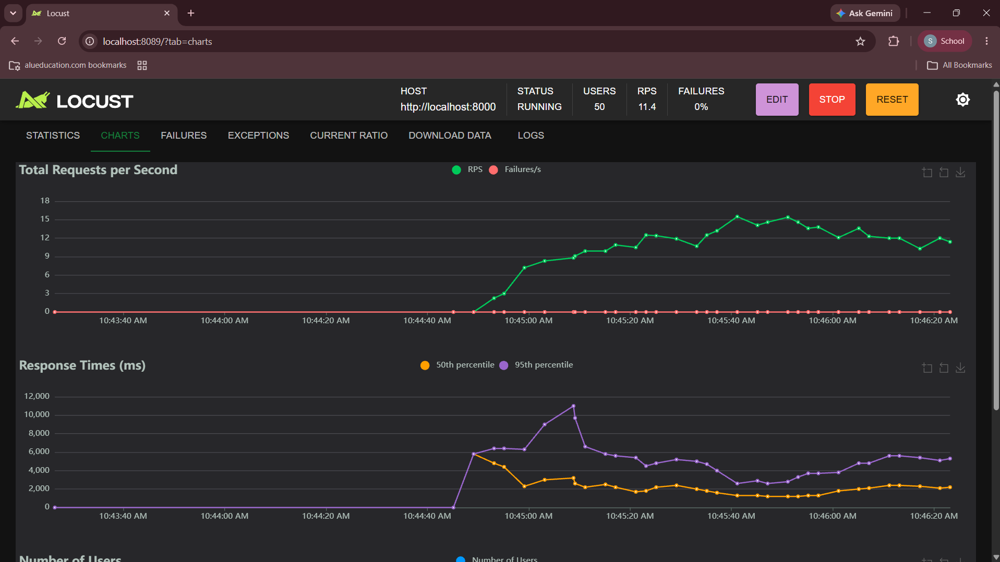
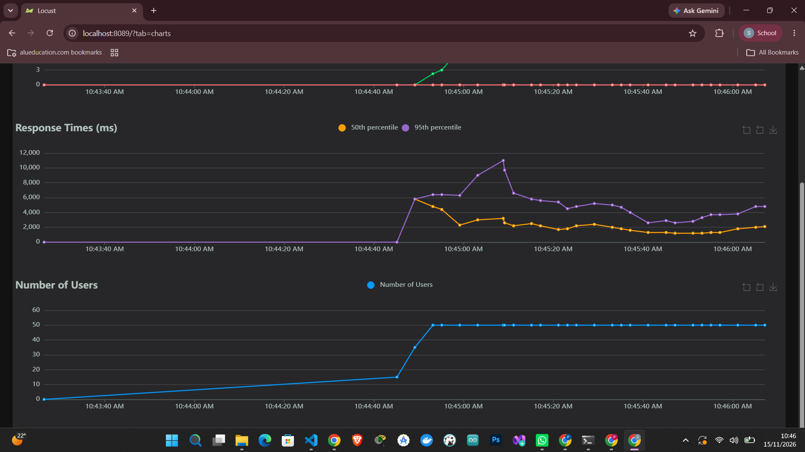
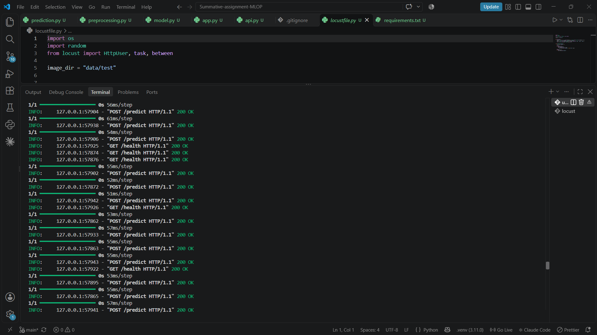
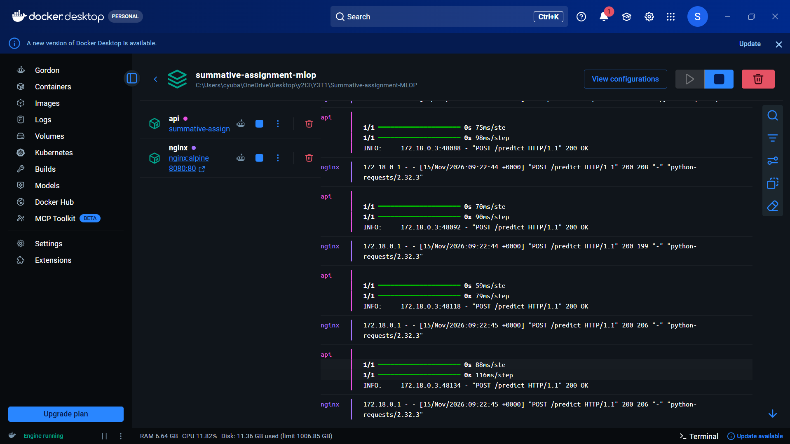

# Maize Leaf Disease Classifier

An end to end machine learning pipeline that classifies a maize leaf photo into one of four health classes and lets a user retrain the model on new images. Built by Steven Kayitare for the MLOps summative, extending an earlier Introduction to Machine Learning project from tabular data to image data.

## Links

- Live app: [https://mldprediction.streamlit.app/](https://mldprediction.streamlit.app/)
- Video demo: [https://youtu.be/cNvpDoZamVc](https://youtu.be/cNvpDoZamVc)
- Dataset: https://www.kaggle.com/datasets/smaranjitghose/corn-or-maize-leaf-disease-dataset

## What it does

The model tells apart four maize leaf conditions: Blight, Common Rust, Gray Leaf Spot, and Healthy. A farmer or field officer uploads a leaf photo and gets back the predicted disease with a confidence score, so a problem can be caught without a lab test. The app also accepts new labelled images and retrains the model on them, so it keeps improving as more field photos come in.

The classifier is a MobileNetV2 transfer learning model. The notebook compares three approaches, a plain CNN, a regularized CNN, and the MobileNetV2 transfer model, and keeps the best one by macro F1. The saved model is reused as the pre-trained base when a user triggers retraining.

## Project structure

```
Summative-assignment-MLOP/
  data/                 train and test images, four class folders each
  models/               maize_model.keras, the trained model
  notebook/             the training notebook
  src/                  preprocessing.py, model.py, prediction.py
  static/               saved insight plots and screenshots
  locust_results/       flood test reports and stats
  app.py                Streamlit web app
  api.py                FastAPI service
  locustfile.py         load test
  Dockerfile            API image
  docker-compose.yml    api plus nginx load balancer
  nginx.conf            balancer config
  requirements.txt
```

## Setup

You need Python 3.11. TensorFlow does not have a stable wheel for newer Python versions, so stay on 3.11.

```bash
python -m venv .venv
source .venv/Scripts/activate      # on Windows Git Bash
pip install -r requirements.txt
```

Run the web app:
```bash
streamlit run app.py
```

Run the API in a second terminal:
```bash
uvicorn api:app --port 8000
```
The interactive API docs are at http://localhost:8000/docs.

## The notebook

Open `notebook/maize_leaf_classifcation.ipynb` in Google Colab. Download the dataset from the Kaggle link above, then upload the four class folders into your Google Drive inside a folder named `maize_data`, so the path is `MyDrive/maize_data/Blight`, `MyDrive/maize_data/Common_Rust`, and so on. Run the cells top to bottom. The notebook mounts your Drive, loads the images, runs the three experiments, evaluates the best one, and saves the model.

## Features

- Predict: upload one leaf image, get the class, a confidence score, and a per class probability chart.
- Insights: three plots that describe the dataset, images per class, average colour per class, and image dimensions, each with a short interpretation.
- Retrain: upload new images by class. They are saved to `data/train` and logged to a SQLite database, then a button retrains the model on the saved base and updates it.
- Status: shows whether the model is present, when it was last updated, how many images have been uploaded, and the app uptime.

### Dataset insights







## API endpoints

| Method | Path | Purpose |
|---|---|---|
| GET | /health | service status, model present, uptime |
| POST | /predict | classify one uploaded image |
| POST | /upload | save uploaded images by class and log them |
| GET | /uploads | list logged uploads |
| POST | /retrain | retrain on the saved base and reload |

## Running with Docker

The API is containerised and sits behind an nginx load balancer, so it can be scaled to several containers that share the load.

```bash
docker compose build
docker compose up --scale api=1
```
The service is reachable at http://localhost:8080, with docs at http://localhost:8080/docs. To run more containers, change the number:
```bash
docker compose up --scale api=3
```

## Flood request simulation

The model was load tested with Locust at 50 concurrent users, ramping up 5 per second, for about one minute. The same test was run against the Dockerised API with one container and then with three containers.

| Setup | Endpoint | Requests | Failures | Median (ms) | 95%ile (ms) | Requests/s |
|---|---|---|---|---|---|---|
| 1 container | POST /predict | 357 | 0 | 3200 | 5500 | 6.48 |
| 1 container | Aggregated | 462 | 0 | 3200 | 5700 | 8.39 |
| 3 containers | POST /predict | 364 | 0 | 1800 | 5200 | 7.52 |
| 3 containers | Aggregated | 502 | 0 | 2000 | 5300 | 10.37 |









Reading the result: moving from one container to three cut the median prediction time from 3200 ms to 1800 ms and raised throughput, with zero failures in every run. The gain is real but bounded, since all three containers share the same CPU on one laptop, so adding containers helps up to the point where they start competing for the same cores. On more machines or more cores the improvement would be larger.

The three API containers and the nginx balancer running together:



A non Docker local baseline was also run directly against the API on port 8000 over a longer window. That report is in `locust_results/` alongside the two Docker reports.

Full reports and raw stats are in `locust_results/`. Screenshots of the run and the running containers are in `static/screenshots/`.

## Rubric mapping

- Evaluation of models: the notebook has clear preprocessing, data augmentation, dropout, batch normalization, early stopping, a pre-trained model, and reports accuracy, precision, recall, F1, and a confusion matrix.
- Prediction: the Predict page and `POST /predict` return the correct class for an uploaded image.
- Retraining: uploads are saved to disk and the database, preprocessed, and used to retrain the saved model as a pre-trained base.
- Deployment: a Streamlit web app with data insights, plus a Dockerised FastAPI service with Swagger docs.
- Load test: Locust results across one and three containers, recorded above.